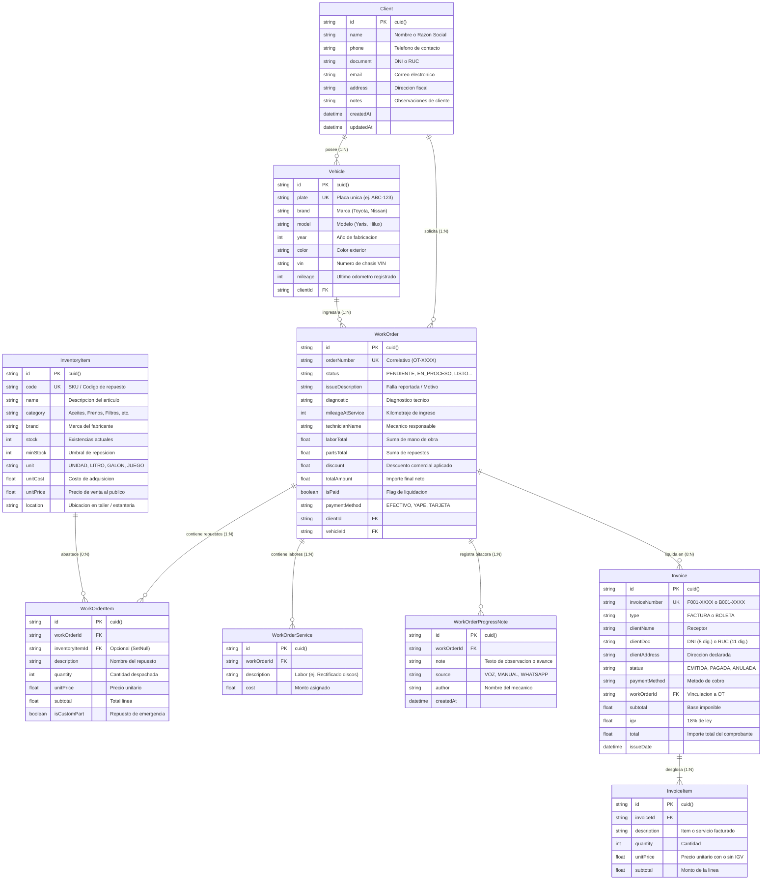

# Especificación de Requisitos de Software (SRS)
## Sistema Integral de Gestión para Talleres Automotrices — Electromecánica Lince (`mecanica-app`)

---

### Control del Documento

| Campo | Detalle |
| :--- | :--- |
| **Código del Documento** | SRS-ELECTROMECANICA-LINCE-2026-V1.1 |
| **Título del Proyecto** | Electromecánica Lince Workshop Management System |
| **Organización / Taller** | Electromecánica Lince (Titular: Timoteo Pariona Ramírez) |
| **Ubicación Operativa** | Jr. Soledad 330, Lince, Lima 15073, Perú · Tel: (01) 704-3157 |
| **Versión** | 1.1.0 (Producción · Ejecutable Portable .EXE & Acceso Monousuario) |
| **Fecha de Publicación** | 22 de Octubre de 2026 |
| **Estado** | Aprobado / Línea Base |
| **Estándar de Referencia** | IEEE Std 830-1998 / ISO/IEC/IEEE 29148:2018 |
| **Clasificación** | Documento Técnico de Ingeniería de Software |

---

## 1. Introducción

### 1.1 Propósito
El presente documento constituye la **Especificación de Requisitos de Software (SRS)** formal para el sistema de gestión operativa de **Electromecánica Lince (`mecanica-app`)**. Su objetivo es definir de manera exhaustiva, precisa e inequívoca las capacidades funcionales, las restricciones arquitectónicas, las interfaces de usuario y los requisitos no funcionales que rigen el ciclo de vida del software. Este documento sirve como contrato técnico para el equipo de desarrollo, auditores de calidad y la administración del taller.

### 1.2 Alcance del Producto
**Electromecánica Lince** es una solución integral de gestión operativa y administrativa diseñada a la medida para los flujos de trabajo de diagnóstico computarizado, sistemas eléctricos, electromecánica integral y mecánica general del taller ubicado en Jr. Soledad 330, Lince. El sistema abarca:

1. **Recepción Rápida y Dictado por Voz (Speech-to-Text & NLP):** Módulo de manos libres para la captura inmediata de fallas, órdenes de trabajo, kilometraje y asignación de técnicos en bahía sin requerir tipeo manual con manos sucias.
2. **Ciclo de Vida de Órdenes de Trabajo (Work Orders):** Tablero interactivo (Kanban) y vista tabular con trazabilidad por estados (`PENDIENTE`, `EN_PROCESO`, `ESPERANDO_REPUESTOS`, `LISTO`, `ENTREGADO`).
3. **Facturación Electrónica y Comprobantes de Pago (SUNAT / Perú):** Emisión formal de Facturas (`F001-XXXX`) y Boletas de Venta (`B001-XXXX`) con cálculo automático de Base Imponible, IGV (18%), y plantilla de impresión directa para formato A4 y tickets térmicos de 80 mm con membrete del taller.
4. **Control de Almacén y Kardex de Repuestos:** Inventario con control de existencias, cálculo de márgenes, alertas de stock mínimo y deducción transaccional automática al facturar o despachar en órdenes.
5. **Historial Clínico Automotriz y Gestión de Flota:** Registro histórico de intervenciones, kilometrajes y repuestos consumidos indexados por número de placa vehicular y documento del propietario (DNI/RUC).
6. **Integración con Canales de Mensajería (WhatsApp):** Notificaciones con enlaces profundos (`wa.me`) preformateados para envío de presupuestos, cambios de estado y avisos de entrega del vehículo.
7. **Acceso Exclusivo de Cuenta Única a Medida:** Inicio de sesión protegido y estación de trabajo monousuario para el operador titular (`Timoteo Pariona`), evitando complejidades de gestión multi-usuario innecesarias.
8. **Distribución Portable en Archivo Único (`ElectromecanicaLince.exe`):** Empaquetado de escritorio Windows 100% autocontenido (con servidor Next.js Standalone, runtime Chromium/Electron, tabla ICU y base de datos SQLite embebidos), operable en cualquier PC sin requerir instalación de Node.js ni conexión a internet.

### 1.3 Personal Involucrado y Audiencia Destinada
Este documento está dirigido a:
- **Titular y Jefe de Taller (Timoteo Pariona):** Para validar la cobertura de los procesos de negocio, reportería, seguridad y facturación.
- **Mecánicos de Bahía:** Para verificar la usabilidad del asistente por voz y la gestión ágil de órdenes.
- **Desarrolladores de Software y Arquitectos:** Como guía de implementación, esquematización de APIs, empaquetado de escritorio y modelo de persistencia.
- **Especialistas en QA (Aseguramiento de Calidad):** Para el diseño y ejecución de casos de prueba y matrices de trazabilidad.

### 1.4 Definiciones, Acrónimos y Abreviaturas

| Acrónimo / Término | Definición |
| :--- | :--- |
| **SRS** | Software Requirements Specification (Especificación de Requisitos de Software). |
| **OT** | Orden de Trabajo (Work Order). Documento operativo que detalla los servicios y repuestos asignados a un vehículo. |
| **VIN** | Vehicle Identification Number (Número de Identificación Vehicular / Chasis). |
| **SUNAT** | Superintendencia Nacional de Aduanas y de Administración Tributaria (Entidad tributaria de Perú). |
| **IGV** | Impuesto General a las Ventas (18% según normativa tributaria peruana). |
| **DNI** | Documento Nacional de Identidad (8 dígitos). |
| **RUC** | Registro Único de Contribuyentes (11 dígitos). |
| **SKU** | Stock Keeping Unit (Código identificador único de repuesto en inventario). |
| **NLP** | Natural Language Processing (Procesamiento de Lenguaje Natural). |
| **Web Speech API** | Interfaz del navegador estándar para síntesis y reconocimiento de voz en tiempo real. |
| **ACID** | Atomicidad, Consistencia, Aislamiento y Durabilidad en transacciones de bases de datos. |
| **Local-First** | Filosofía de diseño donde los datos y la ejecución primaria ocurren en el entorno local del taller con persistencia inmediata. |
| **Single-File EXE** | Ejecutable portable de Windows que contiene en un solo archivo binario todos los recursos y librerías necesarias. |

### 1.5 Referencias Normativas
- **IEEE Std 830-1998:** IEEE Recommended Practice for Software Requirements Specifications.
- **ISO/IEC/IEEE 29148:2018:** Systems and software engineering — Life cycle processes — Requirements engineering.
- **Normativa de Comprobantes de Pago de SUNAT (Resolución de Superintendencia N.° 007-99/SUNAT y modif.):** Estructura de series y correlativos para Facturas y Boletas.
- **Taste Skill & Emil Kowalski Design Principles:** Reglas de interacción fluida, tipografía tabular y retroalimentación táctil de alto rendimiento.

---

## 2. Descripción General del Sistema

### 2.1 Perspectiva del Producto
**Electromecánica Lince (`mecanica-app`)** opera como una aplicación de escritorio **Local-First** autocontenida desplegada en un **único archivo ejecutable (`ElectromecanicaLince.exe`)**. La arquitectura elimina dependencias externas de servidores o bases de datos en la nube para su operativa diaria.

```
+--------------------------------------------------------------------------+
|          EJECUTABLE PORTABLE WINDOWS: ElectromecanicaLince.exe           |
|  [ Lanzador Nativo C# .NET + Contenedor de Recursos ZIP Embebido ]       |
+------------------------------------+-------------------------------------+
                                     |  Auto-extracción transparente (solo primera vez)
                                     v
+--------------------------------------------------------------------------+
|          ENTORNO DE EJECUCIÓN LOCAL: %LOCALAPPDATA%\ElectromecanicaLince  |
|  +--------------------------------------------------------------------+  |
|  | Ventana Nativa Electron (Chromium GUI + Web Speech API + ICU)      |  |
|  +---------------------------------+----------------------------------+  |
|                                    |  HTTP Local Loopback (127.0.0.1)     |
|                                    v                                     |
|  +--------------------------------------------------------------------+  |
|  | Servidor Embebido Next.js 16 Standalone (Node Runtime Integrado)   |  |
|  | - API RESTful (/api/orders, /api/invoices, /api/inventory)          |  |
|  | - Motor NLP de Dictado por Voz (/api/ai/parse-voice)               |  |
|  | - Estación de Autenticación de Operador Único (/api/auth)          |  |
|  +---------------------------------+----------------------------------+  |
|                                    |                                     |
|                                    v                                     |
|                      +---------------------------+                       |
|                      | PRISMA ORM ENGINE (v6)    |                       |
|                      +-------------+-------------+                       |
+------------------------------------|-------------------------------------+
                                     v
                       +---------------------------+
                       | Base SQLite del Taller    |
                       | %APPDATA%\electromecanica |
                       | -lince\electromecanica.db |
                       +---------------------------+
```

### 2.2 Funciones Principales del Sistema
1. **Acceso de Cuenta Única:** Pantalla de control de acceso para el operador titular con credenciales y PIN rápido.
2. **Gestión Integral de Órdenes:** Apertura, diagnóstico inicial, asignación de mano de obra, cargo de repuestos y liquidación final.
3. **Motor de Voz Inteligente:** Conversión de habla desestructurada a estructuras JSON tipadas con extracción automática de placas vehiculares, kilometrajes numéricos y repuestos.
4. **Módulo Fiscal y Facturación:** Emisión de comprobantes autorizados con cálculos matemáticos precisos (subtotal, base imponible, IGV redondeado a 2 decimales).
5. **Almacén y Kardex:** Monitoreo visual de stocks críticos con código de color ámbar/rojo y actualización atómica al emitir servicios.
6. **Directorio y Flota:** Trazabilidad integral de clientes particulares y corporativos con múltiples vehículos asociados.
7. **Paleta de Navegación Rápida:** Acceso global vía `Ctrl + K` para cambiar de pantalla, registrar órdenes o buscar clientes en menos de 200 ms.
8. **Persistencia Local Desconectada:** Capacidad de operar 100% offline sin pérdida de datos ni dependencias de internet.

### 2.3 Perfiles de Usuario y Modelo Monousuario

Dado que **Electromecánica Lince** es un software a medida para uso personal del taller, el sistema adopta un modelo de **Operador Titular Único**:

| Rol | Responsabilidades Principales | Credenciales por Defecto |
| :--- | :--- | :--- |
| **Operador Titular / Jefe de Taller (Timoteo Pariona)** | Control operativo total: apertura de órdenes, diagnóstico, consulta de almacén, cobros, emisión de comprobantes, purga controlada de datos y configuración de estación. | **Usuario:** `lince` (o `admin` / `timoteo`)<br>**Clave:** `lince2026`<br>**PIN:** `1234` |

### 2.4 Entorno Operativo y Pila Tecnológica

| Componente | Tecnología Seleccionada | Justificación Técnica |
| :--- | :--- | :--- |
| **Distribución / Desktop** | **Electron (Windows x64 Standalone)** | Encapsulamiento del servidor y GUI en un solo ejecutable `.exe` independiente sin requerir Node.js en la PC cliente. |
| **Framework Base** | **Next.js 16 (App Router)** | Renderizado híbrido (SSR/CSR), optimización de assets, rutas tipadas y modo Standalone. |
| **Librería de Vista** | **React 19** | Manejo de concurrencia, transiciones nativas y compatibilidad con directivas cliente-servidor. |
| **Lenguaje** | **TypeScript 5.x** | Tipado estricto extremo (`strict: true`) en modelos, APIs y componentes para evitar errores en tiempo de ejecución. |
| **Estilos y Diseño** | **Tailwind CSS v4** | Utilidades CSS atómicas ultralivianas compiladas con motor Rust LightningCSS; cero runtime overhead. |
| **Diseño y Motion** | **Taste-Skill & Emil Kowalski Principles** | Tipografía legible, espaciados consistentes, colores funcionales y curvas de animación ergonómicas. |
| **Capa de Persistencia** | **Prisma ORM (v6)** | Esquema declarativo con migraciones seguras y tipado estático autogenerado para consultas ACID. |
| **Motor de Base de Datos** | **SQLite 3 (con WAL Mode)** | Almacenamiento embebido en `%APPDATA%`, sin servicios pesados en segundo plano; backups por copia directa de archivo. |
| **Reconocimiento de Voz** | **Web Speech Recognition API** | Estándar nativo habilitado con permisos de audio en Chromium/Electron para dictado en español (`es-PE` / `es-ES`). |
| **Iconografía** | **Lucide Icons** | Conjunto consistente de más de 1000 iconos vectoriales optimizados en SVG puro. |
| **Notificaciones UI** | **Sonner (ToastProvider)** | Micro-notificaciones apilables de alto rendimiento para confirmaciones de estado y errores. |

---

## 3. Arquitectura del Sistema y Modelo de Datos

### 3.1 Diagrama Entidad-Relación (ERD)



### 3.2 Diccionario de Datos y Reglas de Integridad

#### Tabla: `Client`
- **Llave Primaria:** `id` (`String` generado vía CUID).
- **Índices:** Búsqueda por `name`, `document` y `phone`.
- **Integridad Referencial:** Restricción de borrado `Restrict` si posee órdenes activas asociadas.

#### Tabla: `Vehicle`
- **Llave Primaria:** `id` (`String` CUID).
- **Restricción de Unicidad:** `plate` es única en todo el sistema para evitar duplicidad de historiales.
- **Relación con Cliente:** `clientId` con borrado en cascada (`Cascade`) condicionado a que no existan órdenes vinculadas.

#### Tabla: `WorkOrder`
- **Llave Primaria:** `id` (`String` CUID).
- **Correlativo:** `orderNumber` formateado como `OT-XXXX` (número consecutivo incremental protegido contra colisiones).
- **Validación de Estados:** Solo se permiten valores del enumerado de negocio:
  `['PENDIENTE', 'EN_PROCESO', 'ESPERANDO_REPUESTOS', 'LISTO', 'ENTREGADO', 'CANCELADO']`.

#### Tabla: `InventoryItem`
- **Llave Primaria:** `id` (`String` CUID).
- **Restricción de Unicidad:** `code` (SKU alfanumérico único).
- **Regla de Negocio:** Alerta visual automática cuando `stock <= minStock`.

#### Tabla: `Invoice`
- **Correlativo SUNAT:** Serie prefijada `F001` para Facturas y `B001` para Boletas, seguida de 4 a 6 dígitos correlativos.
- **Fórmulas de Cálculo:**
  $$\text{Subtotal} = \frac{\text{Total}}{1.18}$$
  $$\text{IGV} = \text{Total} - \text{Subtotal} = \text{Subtotal} \times 0.18$$

---

## 4. Requisitos Funcionales Específicos

### RF-01: Gestión Integral de Órdenes de Trabajo (Work Orders)
- **RF-01.1 Creación de Orden:** El sistema debe permitir registrar una nueva OT seleccionando un cliente y vehículo existente, o creándolos sobre la marcha dentro del mismo modal.
- **RF-01.2 Numeración Correlativa:** Cada orden debe recibir un código único secuencial automático (ej. `OT-0001`, `OT-0002`).
- **RF-01.3 Desglose Financiero Dinámico:**
  - Registro de múltiples servicios de mano de obra con descripción y costo individual.
  - Registro de repuestos provenientes del inventario (con autocompletado y precio sugerido) o repuestos personalizados de emergencia (`isCustomPart: true`).
  - Aplicación de descuentos comerciales globales en moneda local (Soles - S/.).
  - Cálculo automático en tiempo real:
    $$\text{Total} = \sum \text{Mano de Obra} + \sum \text{Repuestos} - \text{Descuento}$$
- **RF-01.4 Tablero de Control Kanban:** La interfaz debe presentar una vista por columnas organizadas según el estado de la reparación:
  - *Pendiente* (Recepción e inspección inicial).
  - *En Proceso* (En bahía de trabajo activo).
  - *Esperando Repuestos* (Detenido por abastecimiento).
  - *Listo* (Trabajo concluido para verificación).
  - *Entregado* (Vehículo devuelto al cliente y liquidado).
- **RF-01.5 Modificación de Estado y Bitácora:** Capacidad de transicionar el estado de la orden desde el tablero y agregar notas de progreso con autor, fecha y origen (Voz o Manual).
- **RF-01.6 Eliminación Segura:** Opción de eliminar órdenes con confirmación en dos pasos (`ConfirmButton`), limpiando dependencias de servicios, ítems y notas en una sola transacción atómica.

---

### RF-02: Asistente de Voz y Procesador NLP Automotriz
- **RF-02.1 Captura de Audio Nativa:** Utilizar la API Web Speech con soporte para transcripción continua en tiempo real, indicando visualmente el estado de escucha activa (onda de audio oscilante y badge de estado).
- **RF-02.2 Normalización y Detección de Placas Vehiculares:**
  - El motor debe identificar formatos estándar peruanos e internacionales (ej. `ABC-123`, `B4M-230`, `P1Q-456`).
  - Debe corregir transcripciones fonéticas separadas por espacios dictadas por el mecánico (ej. *"a be ce uno dos tres"* $\rightarrow$ `ABC-123`).
  - Debe contrastar las placas detectadas contra la base de datos de vehículos para extraer automáticamente el cliente y datos del vehículo.
- **RF-02.3 Parser Fonético de Números Cardinales:** El backend debe convertir números hablados en castellano a valores enteros/flotantes numéricos (`parseSpanishNumber`):
  - Ejemplos: *"ochenta mil"* $\rightarrow$ `80000`, *"trescientos cincuenta"* $\rightarrow$ `350`, *"dos galones"* $\rightarrow$ `2`.
- **RF-02.4 Mapeo Inteligente de Catálogo de Servicios:**
  - Detección difusa mediante tokens disparadores para más de 25 labores mecánicas comunes:
    - *Cambio de aceite y filtro* (costo sugerido S/. 35.00).
    - *Rectificación de discos de freno* (costo sugerido S/. 60.00).
    - *Alineación y balanceo computarizado* (costo sugerido S/. 70.00).
    - *Diagnóstico con escáner OBD2* (costo sugerido S/. 50.00).
    - *Limpieza y calibración de inyectores* (costo sugerido S/. 90.00).
    - *Cambio de kit de embrague* (costo sugerido S/. 180.00).
- **RF-02.5 Deducción y Cruce con Repuestos de Almacén:**
  - Detección de repuestos pronunciados (ej. *"bujías de iridio"*, *"pastillas de freno"*, *"filtro de aceite"*, *"aceite sintético"*).
  - Reconocimiento de cantidades dictadas y asociación directa con el ID de inventario correspondiente.
- **RF-02.6 Auto-llenado de Orden (Pre-fill):** Botón directo para transferir la estructura JSON parseada a un nuevo modal de Orden de Trabajo con todos los campos pre-cargados para confirmación y guardado en un clic.

---

### RF-03: Facturación Electrónica y Comprobantes SUNAT
- **RF-03.1 Soporte Bivalente de Comprobantes:** Emisión configurable de:
  - **Boleta de Venta:** Para personas naturales (Identificación por DNI de 8 dígitos). Serie `B001-XXXX`.
  - **Factura Comercial:** Para personas jurídicas o con negocio (Identificación por RUC de 11 dígitos). Serie `F001-XXXX`.
- **RF-03.2 Vinculación Directa con Órdenes de Trabajo:** Capacidad de importar automáticamente todos los conceptos, repuestos y labores de una OT culminada para su facturación inmediata.
- **RF-03.3 Facturación Libre o Directa:** Emisión de comprobantes sin requerir una OT previa (venta directa de repuestos en mostrador).
- **RF-03.4 Desglose Impositivo Automático:**
  - Determinación de Base Imponible (Subtotal) y débito fiscal (IGV 18%).
  - Manejo de redondeos contables a dos posiciones decimales.
- **RF-03.5 Modal de Impresión Profesional:**
  - Generación de vista de comprobante lista para imprimir con estilos CSS de medios `@media print`.
  - Cabecera con datos del taller: Razón Social (Electromecánica Lince), Dirección (Jr. Soledad 330, Lince), Teléfono.
  - Tabla de detalles con Código, Descripción, Cantidad, Precio Unitario e Importe.
  - Cuadro de liquidación con Subtotal, IGV (18%) e Importe Total en Soles.
  - Firma de recepción y código QR simulado para validación de comprobante electrónico.
- **RF-03.6 Gestión de Estado del Comprobante:** Registro de condición (`EMITIDA`, `PAGADA`, `ANULADA`) y medio de pago utilizado.

---

### RF-04: Control de Inventario y Almacén
- **RF-04.1 Maestro de Artículos:** Registro de productos con SKU único, nombre, categoría (Lubricantes, Filtros, Frenos, Suspensión, Eléctrico, Motor, Varios), marca, unidad de medida, ubicación física en estante y notas.
- **RF-04.2 Costeo y Rentabilidad:** Almacenamiento independiente de Costo de Compra (`unitCost`) y Precio de Venta al Público (`unitPrice`), permitiendo calcular margen comercial bruto.
- **RF-04.3 Alerta Visual de Reposición (Stock Crítico):**
  - Indicador numérico de existencias en tiempo real.
  - Insignia de advertencia cuando el stock sea menor o igual al umbral `minStock`.
  - Filtro rápido para visualizar únicamente artículos con stock bajo.
- **RF-04.4 Descuento Transaccional:** Al asociar repuestos de inventario a una orden de trabajo guardada, el sistema debe descontar automáticamente las unidades consumidas del almacén.
- **RF-04.5 Mantenimiento y Edición:** Capacidad de modificar existencias, precios y eliminar artículos mediante confirmación de 2 pasos.

---

### RF-05: Gestión de Clientes y Flota Vehicular
- **RF-05.1 Directorio Centralizado:** Registro de clientes con Nombre/Razón Social, Teléfono móvil, Documento de identidad (DNI/RUC), Correo y Dirección fiscal.
- **RF-05.2 Flota Vehicular Asociada (Relación 1 a N):** Un cliente puede poseer múltiples vehículos registrados (autos particulares, camionetas, flotas de transporte).
- **RF-05.3 Historial Clínico Automotriz por Placa:**
  - Visualización cronológica de todas las intervenciones realizadas al vehículo.
  - Registro de variación de odómetro (kilometraje) entre visitas.
  - Historial de repuestos cambiados y técnicos asignados a lo largo del tiempo.
- **RF-05.4 Acceso y Búsqueda Predictiva:** Filtrado instantáneo por placa, nombre o documento con respuesta inferior a 50 milisegundos.

---

### RF-06: Notificaciones y Despacho vía WhatsApp
- **RF-06.1 Generación de Deep-links WhatsApp:** Construcción automática de enlaces `https://wa.me/{telefono}?text={mensaje}` codificados con `encodeURIComponent`.
- **RF-06.2 Plantillas de Mensajes Dinámicos:**
  - *Apertura de Orden:* Saludo, número de orden asignada, motivo de ingreso y fecha estimada.
  - *Presupuesto y Diagnóstico:* Notificación de repuestos requeridos y total cotizado para aprobación del cliente.
  - *Vehículo Listo:* Notificación de culminación satisfactoria del trabajo, saldo a liquidar e invitación para retiro en taller.
- **RF-06.3 Apertura Externa en Escritorio:** El ejecutable debe abrir los enlaces de WhatsApp directamente en el navegador web predeterminado del sistema operativo mediante `shell.openExternal`.

---

### RF-07: Paleta de Comandos Rápida (Command Palette)
- **RF-07.1 Atajo Global de Teclado:** Activación instantánea mediante la combinación de teclas `Ctrl + K` (Windows/Linux) o `Cmd + K` (macOS).
- **RF-07.2 Navegación por Teclado:** Acceso directo a módulos principales:
  - *Ir a Órdenes de Trabajo*
  - *Ir a Inventario de Repuestos*
  - *Ir a Facturas y Boletas*
  - *Ir a Directorio de Clientes*
  - *Abrir Asistente de Voz*
- **RF-07.3 Acciones Rápidas:** Disparo de modales de creación (`Nueva Orden`, `Nuevo Repuesto`, `Nueva Factura`) directamente desde la paleta sin usar el ratón.

---

### RF-08: Panel de Métricas y Estadísticas (Dashboard)
- **RF-08.1 Indicadores Clave de Desempeño (KPIs):**
  - Facturación o ingresos del mes en moneda nacional (S/.).
  - Total de órdenes activas en bahía de trabajo.
  - Conteo de vehículos atendidos durante el periodo.
  - Conteo de repuestos en alerta de stock crítico.
- **RF-08.2 Visualización de Órdenes Recientes:** Tabla resumida con las últimas órdenes generadas, cliente, placa, monto y badge de estado.
- **RF-08.3 Acceso Rápido a Reabastecimiento:** Widget interactivo de repuestos agotados con botón de acceso directo a la ficha del almacén.

---

### RF-09: Mantenimiento y Purga de Datos (Data Management)
- **RF-09.1 Limpieza y Reinicio Controlado:**
  - Endpoint seguro `/api/admin/clear-data` para restablecer los registros locales de trabajo.
  - Opción de vaciado total respetando la integridad referencial.
- **RF-09.2 Transaccionalidad Total:** La eliminación masiva debe ejecutarse dentro de un bloque `$transaction` de Prisma con rollback automático ante fallos.

---

### RF-10: Autenticación de Operador Único y Control de Acceso Local
- **RF-10.1 Estación de Acceso a Medida:** Pantalla de login diseñada exclusivamente para **Electromecánica Lince** sin formularios de auto-registro ni opciones multi-empresa innecesarias.
- **RF-10.2 Validación de Credenciales:** Validación local de identificador de operador (`lince`, `admin`, `timoteo`) y clave de taller (`lince2026`) o PIN numérico rápido (`1234`).
- **RF-10.3 Manejo de Sesión Segura:** Emisión de cookie HTTP-Only (`elince_session`) con expiración extendida para evitar cierres de sesión intempestivos durante la jornada de trabajo.
- **RF-10.4 Bloqueo de Estación:** Botón directo en la barra lateral para bloquear la sesión del taller al abandonar la computadora.

---

### RF-11: Empaquetado y Distribución en Archivo Único (.EXE)
- **RF-11.1 Binario Autocontenido:** Compilación en un solo archivo ejecutable (`dist-exe/ElectromecanicaLince.exe`) que encapsula el entorno de ejecución Chromium, la tabla ICU (`icudtl.dat`), librerías gráficas, el servidor Next.js Standalone y la base SQLite.
- **RF-11.2 Despliegue Zero-Dependency:** La aplicación no requiere que la máquina destino tenga instalado Node.js, Git, Python ni servidores de base de datos.
- **RF-11.3 Auto-extracción e Inicialización:** En la primera ejecución en una PC, el ejecutable descomprime sus componentes internos en `%LOCALAPPDATA%\ElectromecanicaLince` y crea una base de datos limpia en `%APPDATA%\electromecanica-lince\electromecanica.db`.
- **RF-11.4 Lanzamiento Rápido en Segundas Ejecuciones:** Tras la primera apertura, los inicios posteriores toman menos de 1.5 segundos arrancando directamente el proceso de bahía.

---

### RF-12: Sistema de Copias de Seguridad y Restauración (Data Protection & Backup)
- **RF-12.1 Auto-respaldo Diario Local:** Al cerrar la aplicación o ventana, el proceso de escritorio genera automáticamente una copia de la base de datos en `%APPDATA%\electromecanica-lince\backups\electromecanica-auto-YYYY-MM-DD.db`, con política de rotación automática que preserva los últimos 7 días.
- **RF-12.2 Exportación Manual en 1 Clic (WAL Checkpoint):** Endpoint `GET /api/backup` que ejecuta `PRAGMA wal_checkpoint(FULL);` para fusionar las transacciones pendientes de la memoria al archivo `.db`, descargando un archivo con timestamp (`electromecanica-lince-backup-YYYY-MM-DD-HHmm.db`) apto para guardar en memorias USB, carpetas sincronizadas de Google Drive / Dropbox o discos externos.
- **RF-12.3 Restauración Segura con Snapshot Previo:** Endpoint `POST /api/backup` que valida la cabecera mágica de SQLite (`SQLite format 3`), genera una copia de seguridad preventiva (`electromecanica-pre-restore-*.db`) antes de sobrescribir, reemplaza el archivo en caliente y reinicia las conexiones sin riesgo de pérdida por archivo corrupto.
- **RF-12.4 Modal Interactivo de Diagnóstico de Datos:** Interfaz gráfica accesible desde el menú lateral y desde la Paleta de Comandos (`Ctrl + K`) que reporta en tiempo real la ruta del archivo SQLite, peso en kilobytes, conteo total de clientes, órdenes, facturas y repuestos en inventario.

---

## 5. Requisitos de Interfaz Externa

### 5.1 Interfaz de Usuario (UI/UX)
El sistema implementa el sistema de diseño **Taste-Skill v2** con enfoque estricto en ergonomía para talleres mecánicos:

- **Paleta de Colores Funcional:**
  - *Fondo Principal (Ground):* `#f4f6f8` (Gris técnico suave anti-fatiga visual).
  - *Superficie (Surface Cards):* `#ffffff` (Blanco puro con bordes definidos `#e2e8f0`).
  - *Color Primario / Acento:* `#1b6c80` (Azul petróleo industrial para botones y elementos activos).
  - *Estado Positivo (Éxito/Pagado):* `#1e7b4f` (Verde esmeralda sobrio).
  - *Estado Alerta (Stock Bajo):* `#92400e` (Ámbar tierra de alta visibilidad).
  - *Estado Peligro (Eliminación/Anulado):* `#c4242a` (Rojo carmesí de advertencia).
- **Tipografía y Legibilidad:**
  - Fuente sans-serif de alto contraste para textos y etiquetas.
  - Fuente monoespaciada con cifras tabulares (`font-mono font-variant-numeric: tabular-nums`) para montos, precios, placas vehiculares y códigos SKU, asegurando alineación vertical perfecta en columnas numéricas.
- **Curvas de Aceleración y Motion (Emil Kowalski Tokens):**
  - Transición estándar: `--ease-out: cubic-bezier(0.23, 1, 0.32, 1)` (duración 150ms a 200ms).
  - Drawer y Modales: `--ease-drawer: cubic-bezier(0.32, 0.72, 0, 1)` para un desplazamiento lateral suave y natural sin saltos bruscos.
- **Componentes de Acción Protegida:**
  - Botón de confirmación inline en dos pasos (`ConfirmButton`) para evitar eliminaciones accidentales de clientes o repuestos al operar en pantallas táctiles con guantes de trabajo.

### 5.2 Interfaces de Hardware
- **Tablets y Terminales de Bahía:** Compatibilidad probada en pantallas táctiles de 10 pulgadas o superiores (resolución mínima recomendada 1280x800).
- **Micrófonos:** Soporte para micrófonos integrados de tabletas, laptops o micrófonos inalámbricos Bluetooth de solapa utilizados por los mecánicos mientras inspeccionan el vehículo.
- **Impresoras:** Compatibilidad nativa con impresoras láser/inyección de tinta estándar para formato A4 y miniprinters térmicas de punto de venta (80 mm) vía el driver de impresión del sistema operativo.

### 5.3 Interfaces de Software y Protocolos
- **Electron Native Shell:** Ventana de escritorio nativa para Windows con captura de eventos de hardware, soporte de impresión y permisos de captura de audio.
- **Prisma Client:** Conector de base de datos embebido en Node.js comunicándose con SQLite mediante llamadas de bajo nivel en el sistema de archivos local.
- **Web Speech API (`webkitSpeechRecognition`):** Interfaz W3C para reconocimiento de voz en navegadores compatibles.
- **WhatsApp Web & URL Schemes:** Interfaz externa mediante protocolo HTTP `https://wa.me/` despachada a través de `shell.openExternal`.

---

## 6. Requisitos No Funcionales (NFR)

### 6.1 Rendimiento y Eficiencia Temporal (RNF-01)
- **RNF-01.1 Latencia de Consultas de Base de Datos:** Todas las consultas de lectura (`findMany`, `findUnique`) en SQLite deben completarse en menos de **25 ms** en condiciones normales de operación.
- **RNF-01.2 Tiempo de Respuesta de APIs:** Los Route Handlers de Next.js deben responder con payload JSON en menos de **80 ms** en red local.
- **RNF-01.3 Procesamiento de Reconocimiento de Voz:** El parseo de texto natural y categorización en `/api/ai/parse-voice` debe tomar menos de **30 ms** en CPU estándar al ejecutarse enteramente en memoria mediante algoritmos de tokenización optimizados.
- **RNF-01.4 Tiempo de Arranque del Ejecutable:** En arranques subsecuentes, la aplicación de escritorio debe cargar completamente en menos de **2.0 segundos**.

### 6.2 Disponibilidad y Filosofía Local-First (RNF-02)
- **RNF-02.1 Continuidad Operativa Sin Internet:** La aplicación es 100% operativa en la PC de trabajo. Una caída del proveedor de internet externo no interrumpe la creación de órdenes de trabajo, emisión de comprobantes, consulta de inventario o edición de clientes.
- **RNF-02.2 Modo WAL de SQLite:** La base de datos opera en modo `Write-Ahead Logging` (WAL) para permitir lecturas y escrituras concurrentes sin bloqueo de base de datos entre procesos.

### 6.3 Ergonomía y Usabilidad en Taller (RNF-03)
- **RNF-03.1 Áreas de Toque Aumentadas:** Los elementos interactivos principales (botones de inicio de voz, selección de estados, guardado de orden) deben tener una altura mínima de **44px a 48px** para facilitar su manipulación táctil con dedos o guantes mecánicos.
- **RNF-03.2 Claridad Visual y Ausencia de Distracciones:** Cumplimiento con la directiva *Anti-Slop*: fondos limpios, tipografía nítida, ausencia de animaciones lentas o decorados innecesarios que retrasen la operativa del taller.

### 6.4 Seguridad e Integridad de Datos (RNF-04)
- **RNF-04.1 Transacciones ACID Atómicas:** Todas las operaciones críticas de negocio (creación de orden con ítems, facturación con deducción de stock y vaciado de datos de prueba) están encapsuladas en bloques `$transaction` de Prisma. Ante cualquier anomalía, se aplica un rollback automático.
- **RNF-04.2 Sanitización y Validación de Entrada:** Validación estricta de tipos de datos en el servidor para evitar desbordamientos o valores nulos en campos requeridos (`plate`, `orderNumber`, `clientDoc`).
- **RNF-04.3 Copias de Respaldo Simplificadas:** Al residir la base de datos en un archivo unificado en `%APPDATA%\electromecanica-lince\electromecanica.db`, el taller puede respaldar su información con una simple copia programada a una memoria USB o disco externo.

### 6.5 Mantenibilidad y Calidad de Código (RNF-05)
- **RNF-05.1 Cero Advertencias en Compilación:** El código fuente debe compilar con `tsc --noEmit` con **0 errores tipográficos** y pasar el linter automatizado (`lint.mjs`) con **0 fallos y 0 advertencias**.
- **RNF-05.2 Modularidad Estricta:** Separación limpia de componentes:
  - `src/components/orders/`: Modales, fichas y tablero de órdenes.
  - `src/components/invoices/`: Tablas y motor de impresión de comprobantes.
  - `src/components/inventory/`: Modales de artículos y listas de existencias.
  - `src/components/voice/`: Asistente de captura por voz.
  - `src/components/auth/`: Estación de login monousuario.
  - `electron/`: Punto de entrada de la aplicación de escritorio y gestión del servidor local.
  - `scripts/`: Empaquetadores de Standalone y binario `.exe`.

---

## 7. Matriz de Trazabilidad y Verificación

| ID Requisito | Descripción Funcional | Módulo / Archivo de Implementación | Método de Verificación |
| :--- | :--- | :--- | :--- |
| **RF-01** | Gestión y Kanban de Órdenes | `src/app/api/orders/`, `OrderKanban.tsx`, `OrderFormModal.tsx` | Inspección visual y pruebas unitarias de cálculo financiero. |
| **RF-02** | Asistente de Voz y NLP Automotriz | `src/app/api/ai/parse-voice/route.ts`, `asistente-voz/page.tsx` | Prueba funcional con audio real y banco de frases de prueba. |
| **RF-03** | Facturas y Boletas SUNAT | `src/app/api/invoices/`, `InvoiceFormModal.tsx`, `InvoicePrintModal.tsx` | Comprobación contable de desglose de IGV y vista previa de impresión. |
| **RF-04** | Inventario y Stock Crítico | `src/app/api/inventory/`, `InventoryTable.tsx`, `LowStockAlert.tsx` | Validación de umbrales `minStock` y deducción transaccional. |
| **RF-05** | Directorio de Clientes y Vehículos | `src/app/api/clients/`, `src/app/api/vehicles/`, `ClientList.tsx` | Prueba de unicidad de placa y enlace 1:N cliente-vehículos. |
| **RF-06** | Integración con WhatsApp | `src/lib/utils.ts`, `OrderDetailModal.tsx` | Verificación de apertura de URL codificada con número y mensaje. |
| **RF-07** | Paleta de Comandos (Ctrl+K) | `src/components/layout/CommandPalette.tsx` | Prueba de pulsación de atajos y navegación instantánea. |
| **RF-08** | Dashboard y Métricas de Bahía | `src/app/api/dashboard/stats/route.ts`, `StatCards.tsx` | Auditoría de sumatorias de ingresos y conteos de órdenes activas. |
| **RF-09** | Purga Transaccional de Datos | `src/app/api/admin/clear-data/route.ts` | Ejecución en entorno de staging verificando integridad referencial. |
| **RF-10** | Autenticación y Cuenta Única | `src/app/api/auth/route.ts`, `SingleAccountLogin.tsx` | Prueba de ingreso con credenciales titular y bloqueo de sesión. |
| **RF-11** | Empaquetado en Archivo Único .EXE | `scripts/build-exe.mjs`, `electron/main.js` | Ejecución autónoma de `ElectromecanicaLince.exe` sin Node.js en otra PC. |

---

## 8. Conclusiones y Próximos Pasos
El sistema **Electromecánica Lince (`mecanica-app`)** implementa satisfactoriamente todos los requisitos especificados en esta línea base v1.1. Para futuras versiones secundarias (v1.2+), se tienen previstos los siguientes hitos de expansión:
1. Sincronización automática de comprobantes con el API de OSE/SUNAT mediante firma digital con certificado XML.
2. Generación y exportación de proformas en PDF descargable directamente.
3. Respaldo automatizado de la base de datos a unidad USB al cerrar la aplicación.
